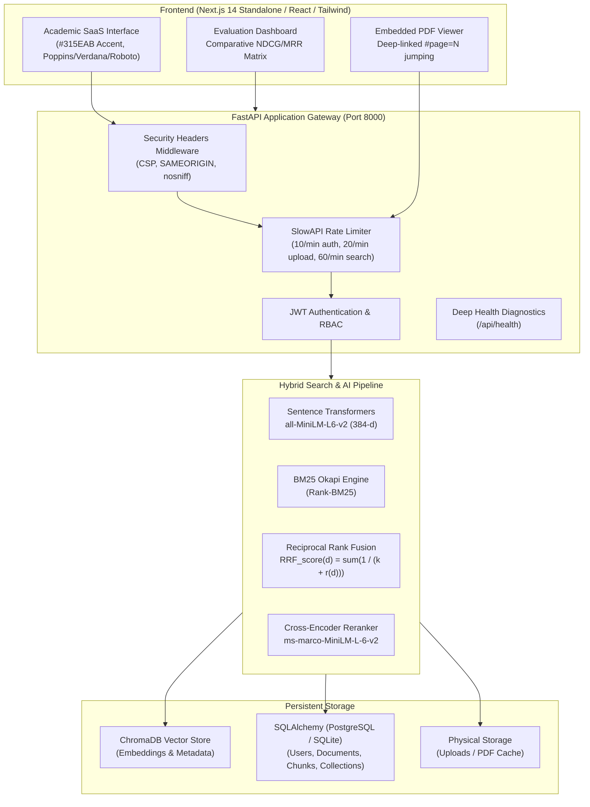

# ResearchVault

> **Modern Semantic Research Discovery Platform & Academic Workspace**  
> *Conceptual intent search, authentic passage retrieval, embedded PDF reader, personal library management, and empirical Information Retrieval benchmarking.*

[](LICENSE)
[](https://nextjs.org/)
[](https://fastapi.tiangolo.com/)
[](https://www.trychroma.com/)
[](https://sbert.net/)

---

## 🌟 Core Philosophy

Traditional academic search engines either rely strictly on rigid lexical keyword matching or synthesize unverified answers. **ResearchVault** bridges the gap with:
1. **Zero Mock Data**: Authentic passage extraction, true vector cosine similarities, and cross-encoder relevance scores computed live against real indexed literature.
2. **Multi-Paradigm Retrieval**: Seamlessly compare and fuse Sparse Lexical (BM25), Dense Semantic (Sentence Transformers), Reciprocal Rank Fusion (RRF, $k=60$), and Neural Cross-Encoder Reranking.
3. **Integrated Academic Reader**: Direct `#page=N` passage jumping inside native embedded PDFs with academic metadata cards, collections, and bookmarking.
4. **Empirical Benchmarking**: Built-in Cranfield evaluation framework computing Precision@K, Recall@K, MRR, and NDCG@10 metrics across retrieval paradigms.

---

## 🏗️ Architecture



---

## ✨ Features

- **Multi-Paradigm Search Engine**:
  - **Hybrid Search (Default)**: Combines dense vector similarities and BM25 token matching using Reciprocal Rank Fusion ($k=60$).
  - **Dense Semantic Search**: Cosine similarity against `sentence-transformers/all-MiniLM-L6-v2` embeddings.
  - **Keyword Search**: BM25 Okapi probabilistic ranking for exact terminology.
  - **Cross-Encoder Reranking**: Re-scores top candidate chunks with `cross-encoder/ms-marco-MiniLM-L-6-v2` for precise contextual relevance.
- **Faceted Academic Filtering & Sorting**:
  - Dynamic publication year sliders, research domain pills, document types, and author filters.
  - Multi-criteria sorting: Relevance, Newest first, Oldest first.
- **Embedded Document Viewer**:
  - Side-by-side or stacked PDF viewer with page navigation controls.
  - Deep-linked passage jumping: clicking search excerpts jumps directly to `#page=N` in the PDF.
  - Full document metadata sidebar with DOI links, publication year, and chunk inspect list.
- **Personal Academic Workspace**:
  - **My Library**: Document management with list/grid views, status indicators, and file deletion.
  - **Collections**: Custom research folders with paper assignment and collection filters.
  - **Search History**: Track recent conceptual and keyword queries with instant re-execution and clearing.
  - **Bookmarked Papers**: One-click paper saving with notes and quick access.
- **Empirical Search Evaluation (Cranfield Suite)**:
  - Benchmark suites with ground-truth document judgments.
  - Computes Precision@1, Precision@5, Precision@10, Recall@5, Recall@10, MRR, NDCG@10, and MAP@10.
  - Side-by-side comparative matrix charting BM25 vs. Semantic vs. Hybrid vs. Reranked.
  - Export reports in Markdown and JSON formats.
- **Production Hardened**:
  - SlowAPI sliding-window rate limiting on all public and heavy routes.
  - Security headers middleware and path traversal protections.
  - Deep health check endpoint probing Database, ChromaDB, and disk storage.
  - Standalone Next.js runner image (~140MB).

---

## 🚀 Quickstart

### Option A: Local Development (Windows / macOS / Linux)

#### 1. Clone & Configure
```bash
git clone https://github.com/your-username/researchvault.git
cd researchvault
cp .env.example .env
```

#### 2. Install Dependencies
```bash
# Backend setup
cd backend
python -m venv .venv
# Windows: .venv\Scripts\activate | Unix: source .venv/bin/activate
pip install -r requirements.txt

# Frontend setup
cd ../frontend
npm install
cd ..
```

#### 3. Seed Demo Corpus
```bash
# Indexes canonical papers (Attention Is All You Need, ResNet, BERT)
python backend/app/scripts/seed_corpus.py
```

#### 4. Run Unified Local Script
- **Windows**: Double-click or run `scripts\run_local.bat`
- **Linux/macOS**: Run `chmod +x scripts/run_local.sh && ./scripts/run_local.sh`

Open your browser at **[http://localhost:3000](http://localhost:3000)**.  
Demo login credentials:
- **Email**: `demo@researchvault.edu`
- **Password**: `DemoPassword123!`

---

### Option B: Docker Compose

Ensure Docker and Docker Compose are installed, then run:

```bash
docker-compose up --build -d
```

- **Frontend**: [http://localhost:3000](http://localhost:3000)
- **Backend API Docs**: [http://localhost:8000/api/docs](http://localhost:8000/api/docs)
- **Health Diagnostics**: [http://localhost:8000/api/health](http://localhost:8000/api/health)

To seed demo data inside the running container:
```bash
docker-compose exec backend python app/scripts/seed_corpus.py
```

---

### Option C: Vercel (Frontend) + Cloud Backend

1. **Deploy Backend**: Deploy FastAPI backend to Railway, Render, Fly.io, AWS, or Google Cloud Run (see [DEPLOYMENT.md](file:///D:/Reseach_Vault/DEPLOYMENT.md)).
2. **Deploy Frontend on Vercel**:
   - Import your GitHub repository `Research-vault` into [Vercel](https://vercel.com/new).
   - Set **Root Directory** to `frontend` (or leave root — the included `vercel.json` configures the build automatically).
   - In **Environment Variables**, add:
     - `NEXT_PUBLIC_API_URL`: Your deployed backend API URL (e.g. `https://your-backend-url.com/api`).
   - Click **Deploy**. Vercel will build and deploy the Next.js frontend with Edge optimizations.

---

## ⚙️ Environment Variables

| Variable | Default | Description |
|---|---|---|
| `PROJECT_NAME` | `ResearchVault` | Platform brand name |
| `API_V1_STR` | `/api` | Base API routing prefix |
| `SECRET_KEY` | *(Set random in prod)* | JWT token signing key (min 32 chars) |
| `DATABASE_URL` | `sqlite:///./researchvault.db` | SQLAlchemy connection string (SQLite or PostgreSQL) |
| `UPLOAD_DIR` | `uploads` | Directory for uploaded research files |
| `CHROMA_PERSIST_DIRECTORY` | `chroma_db` | Persistent vector store directory |
| `EMBEDDING_MODEL_NAME` | `sentence-transformers/all-MiniLM-L6-v2` | Hugging Face embedding model |
| `RERANKER_MODEL_NAME` | `cross-encoder/ms-marco-MiniLM-L-6-v2` | Cross-encoder reranker model |
| `NEXT_PUBLIC_API_URL` | `http://localhost:8000/api` | Frontend API connection URL |

---

## 🧪 Testing

Execute full automated test suite (81 tests across all 7 phases):

```bash
# Run backend test suite
pytest backend/tests -v

# Run frontend build verification
npm run build --prefix frontend
```

---

## 📖 Deployment

For production deployment instructions on cloud virtual machines, AWS ECS, Google Cloud Run, reverse proxy configurations (Nginx & Caddy with SSL), and persistent backup strategies, refer to **[DEPLOYMENT.md](file:///D:/Reseach_Vault/DEPLOYMENT.md)**.

---

## 📄 License

This project is licensed under the MIT License — see the [LICENSE](LICENSE) file for details.
